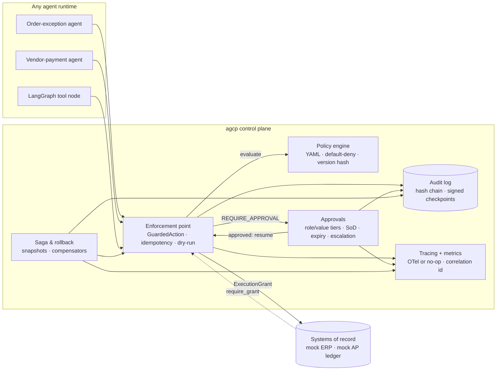

# Agentic Governance Control Plane (`agcp`)

**Controls that let AI agents act on ERP-style systems safely, and let you prove it.** `agcp` is a
small, framework-agnostic Python library. It sits between any agent and any system of record, and
makes every write pass a versioned policy decision, a human approval where required, and an
append-only audit trail with rollback.

> Reference implementation on **synthetic data** (see [docs/data.md](docs/data.md)). Example outputs
> show control mechanics, not business results.

Part of a series: [order-exception-agents](https://github.com/padmanpisupati/order-exception-agents)
(workflow) · [order-exception-eval-harness](https://github.com/padmanpisupati/order-exception-eval-harness)
(go/no-go gate) · **agentic-governance-control-plane** (controls, reusable across workflows).

## Why it matters (the 2-minute version)

| Executive concern | Control in `agcp` | Evidence produced |
|---|---|---|
| "Can an agent do something nobody approved?" | Default-deny policy-as-code before every action. Adapters refuse writes without an execution grant | `policy.decision` record with rule ids, bundle version and hash on every action |
| "Who signed off, and could they approve their own request?" | Approval routing by role and value tier, four-eyes, segregation of duties, expiry and escalation | `approval.*` records, with blocked SoD attempts logged |
| "Can we trust the log?" | SHA-256 hash chain, append-only sinks, HMAC-signed checkpoints | `verify()` pass/fail, plus an exportable anchor |
| "What if it goes wrong halfway?" | Saga compensation, manual rollback by correlation id, idempotency keys | `action.compensated` with before/after state |
| "How do we expand autonomy safely?" | Thresholds live in YAML owned by the process owner. Changes are versioned and audited. Dry-run lets you preview them | `policy.changed` records, and decisions tagged with the new hash |

**Outcome framing:** autonomy grows one rule at a time (raise an auto-release threshold, add a time
window). Every expansion is reviewable and reversible, and its effect on the control KPIs below can
be measured.

## Control KPIs (measured by the examples, not targets)

| KPI | Definition | Desired direction |
|---|---|---|
| Unguarded writes | `action.executed` records without a `decision_id`, plus adapter writes outside a grant | Always 0 (hard control) |
| Audit integrity | `AuditLog.verify(anchor=...)` result | Always pass |
| Auto-execution rate | Executed actions with no approval record ÷ executed | ↑ as trust grows |
| Approval latency p50 | Approval request to decision | ↓ |
| Expiry / escalation rate | Expired or escalated ÷ requested | ↓ |
| SoD violations blocked | Self-approval or duplicate approver attempts | Visible, investigated |
| Compensation rate and success | Compensated ÷ executed, and `matches_before` | Low rate, 100% success |
| Denials by rule | `agcp_denials_total{action}` with rule ids | Tracked per release |

`examples/common.py::control_kpis()` computes these from the audit trail.

## Architecture



More diagrams: [component](docs/diagrams/component.md) · [enforcement sequence](docs/diagrams/enforcement-sequence.md) ·
[saga/rollback](docs/diagrams/saga-rollback.md) · [approval state machine](docs/diagrams/approval-state-machine.md)

## Control-objective mapping (generic control families)

| Control family | Objective | How `agcp` meets it | Test |
|---|---|---|---|
| Access control and least privilege | Agents can only perform declared actions within limits | Action allow-list, default-deny, actor/kind conditions, action-scoped grants | `test_policy`, `test_guard_bypass_impossible` |
| Segregation of duties | Requester ≠ approver; sensitive changes need two people | SoD and four-eyes checks, human-only approvers, role ranks | `test_approvals` |
| Authorization and approval limits | Value-based delegation of authority | Router tiers plus rule-level approval blocks, stricter wins | `test_router_tiers_and_policy_override` |
| Change management | Control changes are versioned, reviewed and traceable | Bundles in git, SHA-256 hash per decision, audited hot-swap, stale approvals re-evaluated | `test_policy_change_is_audited`, `test_stale_approval_reevaluated_after_policy_change` |
| Audit trail and logging integrity | Complete, tamper-evident record of who did what, when and why | Hash chain, append-only SQLite, HMAC checkpoints, external anchor | `test_audit` |
| Transaction integrity and recovery | Partial failures are reversed and no duplicates occur | Sagas, compensators, rollback by correlation id, idempotency keys | `test_saga`, `test_idempotency_*` |
| Monitoring | Controls are observable in real time | OTel spans, metrics hook, correlation ids shared with audit | `test_tracing` |
| Time-based restrictions | Sensitive changes only in staffed windows | `time_window` conditions | `test_time_window` |

## Quickstart

```bash
python3 -m venv .venv && .venv/bin/pip install -r requirements.txt
make test            # or: PYTHONPATH=src:. .venv/bin/python -m pytest -q
make examples        # order exception, vendor payment, LangGraph integration
```

```python
from agcp import build_control_plane, Principal, correlation, require_grant

cp = build_control_plane("policies/vendor_payment.yaml")

@cp.action("ap.place_hold", resource=lambda p: ledger.get(p["invoice_id"]))
def place_hold(invoice_id, reason):
    ledger.hold(invoice_id, reason)      # adapter calls require_grant() inside

agent = Principal("agent:ap", "agent", kind="agent")
with correlation("case-123"):
    place_hold(actor=agent, confidence=0.97, idempotency_key="case-123:hold",
               invoice_id="INV-5001", reason="variance")
cp.audit.verify().ok   # True
```

## What the examples show

| Example | Domain | Demonstrates |
|---|---|---|
| `examples/order_exception` | Order-to-cash, mock ERP (DataCo-schema synthetic orders) | Auto vs approval vs deny, fraud deny, dry-run, idempotent retry, blocked direct write, saga compensation after an injected ERP timeout, approval expiry and escalation, SoD on cancellation, manual rollback, audited policy change (v1.0.0 → v1.1.0) |
| `examples/vendor_payment` | Procure-to-pay, mock AP ledger and bank gateway | Value-tier routing, variance rules, vendor-status deny, nested payment saga with automatic ledger reversal, two-person bank-detail change, governed rollback (agents denied) |
| `examples/langgraph_integration` | Same tools in a LangGraph `StateGraph` | Graph branches on the decision. Falls back to a sequential runner without LangGraph |

Both domains use the **same unmodified library**. Only the policy bundle, adapters and compensators differ.

## Repository layout

```
src/agcp/        policy · guard (enforcement, approvals glue, saga, rollback) · approvals · audit · tracing · context · bootstrap
policies/        order_exception.yaml · vendor_payment.yaml (rules + approval routing)
examples/        order_exception/ · vendor_payment/ · langgraph_integration/ · common.py (KPIs)
tests/           policy · guard · audit · approvals · saga · tracing · reuse/examples
docs/            adr/0001-0005 · diagrams/ · data.md
scripts/         generate_sample.py (synthetic data)
```

## Decision records
[0001 library, not gateway](docs/adr/0001-library-not-gateway.md) ·
[0002 policy-as-code, default-deny](docs/adr/0002-policy-as-code-default-deny.md) ·
[0003 guard + execution grant](docs/adr/0003-guard-and-execution-grant.md) ·
[0004 hash-chained audit + checkpoints](docs/adr/0004-hash-chained-audit-with-checkpoints.md) ·
[0005 HITL, SoD, saga compensation](docs/adr/0005-hitl-sod-and-saga-compensation.md)

## Limits and production roadmap
- **Demo HMAC key.** `DEMO_HMAC_KEY` is for demonstration only. Use a KMS/HSM key, rotate it, or switch to asymmetric signatures.
- **Single process.** The idempotency cache is in memory. Use Redis or a database for multiple replicas, and serve bundles centrally (sidecar or gateway).
- **Python privacy is not a security boundary.** The execution grant is defence in depth. Production systems of record should also verify a signed per-request token on their side.
- **Mock adapters only.** Compensators in real systems need idempotent, business-approved reversal transactions.
- **Small rule language.** OPA or Cedar can be swapped in behind `PolicyEngine.evaluate()`.

## License
MIT. See [LICENSE](LICENSE).
