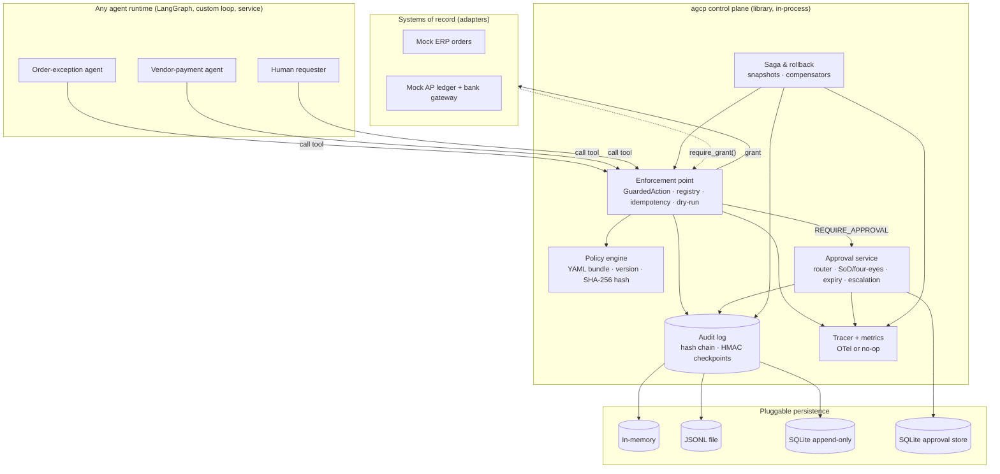

# Component view

| Component | Module | Responsibility |
|---|---|---|
| Policy engine | `agcp.policy` | Pure function: context → ALLOW / REQUIRE_APPROVAL / DENY + matched rules + bundle version/hash |
| Enforcement point | `agcp.guard.ControlPlane` | Only path to execute a registered action; issues the execution grant |
| Execution grant | `agcp.context` | Context-local capability; adapters call `require_grant()` before any write |
| Approval service | `agcp.approvals` | Routing by role and value tier, durable pending requests, SoD, expiry, escalation |
| Saga / rollback | `agcp.guard` | Compensation in reverse order, before/after snapshots, rebuilt from the audit log |
| Audit log | `agcp.audit` | Append-only, hash-chained, pluggable sinks, signed checkpoints, `verify()` |
| Observability | `agcp.tracing` | OTel-compatible spans, metrics hook, correlation ids shared with audit |
